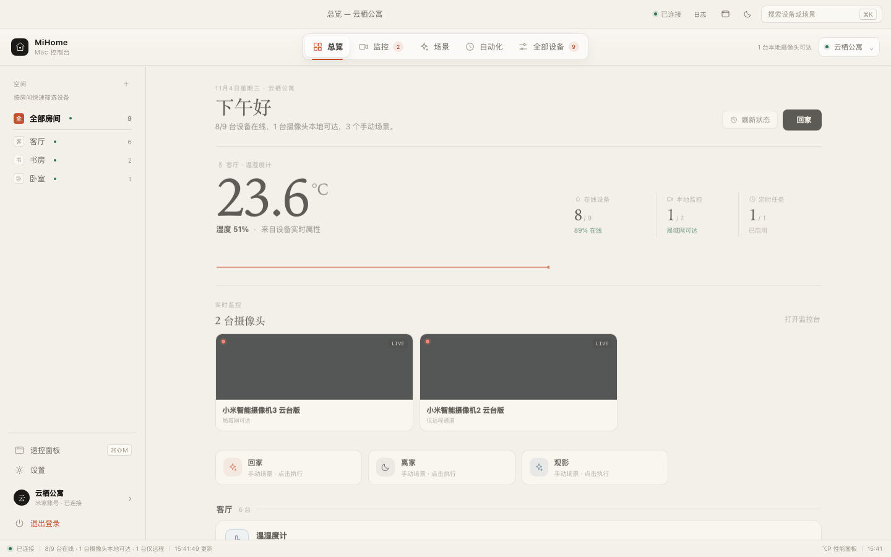
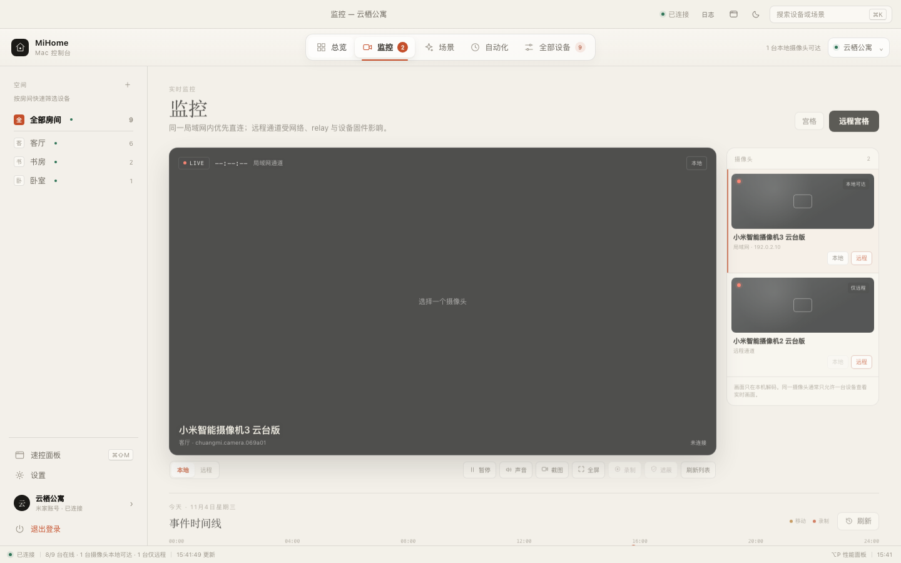
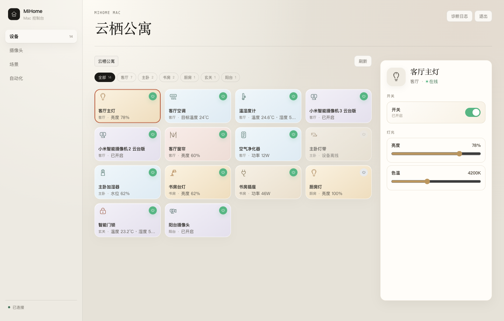

# MiHome Mac

一个面向 macOS 的开源、非官方米家桌面客户端。项目使用 Rust 构建本地核心，以 Tauri 2 提供桌面窗口，支持扫码登录、家庭与设备管理、设备控制、场景执行、定时自动化以及摄像头查看。

[](LICENSE)


> 本项目与小米公司没有隶属或官方关联。项目使用非公开、非官方接口，接口和协议可能随服务端更新而变化，请自行评估使用风险。

> **界面说明：** 下方截图来自当前桌面应用的真实界面，使用离线演示数据。桌面端现已按 `prototype/index.html` 完成顶部一级导航、总览、监控、场景、自动化、全部设备、设置与登录页的视觉对齐；米家接口未开放的能力会明确禁用或显示空状态，不会用原型数据伪造结果。验收记录见 [UI 设计对齐路线](docs/08-ui-design-parity.md)。



<sub>当前桌面应用 · 总览页（离线演示数据）。视觉、信息层级和顶部导航已按交互原型落地。</sub>

## 下载

macOS 1.3.0 提供两个独立安装包：

- [Apple Silicon（arm64）DMG](https://github.com/Reign9201/mihome-mac/releases/download/v1.3.0/MiHome-Mac-1.3.0-arm64.dmg)
- [Intel（x64）DMG](https://github.com/Reign9201/mihome-mac/releases/download/v1.3.0/MiHome-Mac-1.3.0-x64.dmg)
- [SHA256 校验值](https://github.com/Reign9201/mihome-mac/releases/tag/v1.3.0)

两个安装包都内置对应架构的 go2rtc 和按摄像头链路裁剪的最小静态 FFmpeg，摄像头取流与转码不要求用户安装 Homebrew 或其他额外依赖。当前发布包使用 ad-hoc 签名，没有 Developer ID 证书和 Apple 公证；首次打开如被 Gatekeeper 拦截，需要在访达中右键应用并选择“打开”。完整发布说明和校验值见 [v1.3.0 Release](https://github.com/Reign9201/mihome-mac/releases/tag/v1.3.0)。

### 1.3.0 更新

- 插座等计量设备可在详情里查看 7 天、30 天、12 个月用电柱状图，以及合计和平均值。
- 小爱音箱详情可以输入文字让音箱执行或播报，支持“不出声”和一排播放控制按键。
- 顶部导航显示温湿度、开着和在线的设备数，耗材剩余不到 20% 时提醒；经典设备卡片样式可在设置里切换。
- 监控页支持搜索和宫格分页，点一格直接看单画面，某一路出不了画不影响其他画面；150 台摄像头时监控页高度从约 25700px 降到约 1000px。
- 飞书机器人进群自动发欢迎语，平台连接失败按原因提示，回复设备状态时带单位。
- 变更明细见 [CHANGELOG](CHANGELOG.md)，安装包校验值和测试范围见 [1.3.0 发布记录](docs/15-release-1.3.0.md)。

### 1.2.0 更新

- 接入中心支持飞书、企业微信和钉钉机器人长连接，不需要公网回调，并提供连接测试、配对和断线恢复。
- 支持本地规则和 OpenAI 兼容模型解析组合、批量、排除范围、状态查询、场景执行等自然语言指令。
- 飞书语音在本机通过 Whisper.cpp 转写；企业微信和钉钉优先使用平台语音转写。
- 新增 35 个界面 locale、阿拉伯语/希伯来语 RTL 布局和设置页即时切换。
- 修复共享设备不显示、401 后二维码卡住、同房间多灯误判、控制后状态回读延迟和睡眠后长连接失联。
- 变更明细见 [CHANGELOG](CHANGELOG.md)，安装包校验值、测试范围和体积说明见 [1.2.0 发布记录](docs/14-release-1.2.0.md)。

## 功能

- 使用米家 App 扫码登录，无需在应用中保存账号密码
- 支持多账号保存、切换、添加与退出当前账号；账号之间的家庭、设备、摄像头、场景和自动化数据完全隔离
- 单个账号仍可通过顶部家庭选择器切换多个家庭
- 读取家庭、房间和设备列表，展示设备在线状态与连接方式
- 按 MIoT-Spec 动态生成设备能力，只向规格声明可写的属性发送控制
- 执行米家手动场景，保存并运行本地定时自动化
- 查看同一局域网内的摄像头画面，优先使用低延迟实时传输
- 不在同一局域网时，可通过应用内置的远程连接查看画面
- 远程画面支持音频监听，声音开关不会重建已建立的视频通道
- 播放失败时自动切换兼容模式，减少黑屏和长时间等待
- 远程宫格逐路出画，较快的摄像头不再等待较慢的一路
- 支持监控宫格、暂停/继续、声音、截图、全屏、云台控制和单步云台操作
- 设备卡片提供常用指标、开关和快捷控制，摄像头设置按型号中文化
- 插座等计量设备可查看 7 天、30 天、12 个月的用电统计
- 小爱音箱支持文字指令、文字播报和播放控制
- 菜单栏速控面板：左键点菜单栏图标弹出室温湿度和常用设备的开关，点面板外任意位置收起；面板里显示哪些设备和场景在设置里挑，按米家账号分别保存
- 设备在线状态自动同步，窗口重新聚焦或从后台恢复时立即刷新；路由器不会把指示灯状态误当成整机电源
- 内置独立诊断日志，可导出脱敏汇总并定位取流失败
- 支持 AI 意图解析、飞书/企业微信/钉钉长连接、语音转写、一次性配对绑定和本地受控执行
- 支持 35 个国家和地区的界面语言、阿拉伯语/希伯来语 RTL 布局，以及设置页即时切换
- 附带可离线打开、无需真实账号的设计目标原型（非当前应用界面）
- 应用窗口内全局禁用文本选择、拖拽、复制、剪切和右键菜单



<sub>当前桌面应用 · 监控页（离线演示数据）。事件时间线在厂商接口没有事件数据时显示真实空状态。</sub>



<sub>当前桌面应用 · 全部设备页（离线演示数据）。筛选、搜索、连接路径和设备状态均来自真实渲染流程。</sub>

## 界面状态与设计目标

- **当前界面基线：** `desktop/ui/` 和本页实际应用截图，已按 `prototype/index.html` 完成主要页面与外壳对齐。
- **设计源文件：** `prototype/index.html`、`docs/02-product-design.md` 和 `docs/assets/shot-*.jpg` 仍是布局、字体、配色和交互的源规范。
- **接口边界：** 录制、隐私遮蔽、云端录像事件等米家未开放的能力会在界面中禁用或显示空状态，不用演示数据冒充真实结果。
- **界面素材规范：** README 和商店页必须使用当前实际应用截图或录屏，并标注“实际界面 · 演示数据”；不能把尚未接入的能力描述为已完成。

## 当前状态

桌面端已经实现扫码登录、家庭与设备读取、常用属性读写、手动场景和摄像头取流链路。当前仓库的自动化测试、静态检查和离线交互回归已经通过；不同设备型号、固件和网络环境仍需要在真实环境中逐步建立兼容性清单。

多账号登录凭据保存在 macOS 钥匙串条目 `com.reign9201.mihomemac` / `mijia-accounts` 中；每个账号的本地自动化保存在 `~/Library/Application Support/MiHome/automations/<sha256(user_id)>.json`。老版本写在明文文件 `accounts.json` 里的凭据会在首次启动时迁入钥匙串，随后删除明文副本；旧版单账号 `session.json` 同样会自动迁移。钥匙串不可用时退回 `0600` 私有文件写入。当前构建使用 ad-hoc 签名，升级后系统可能重新要求钥匙串授权；该回退路径不能防御同一 macOS 账号下的恶意进程，正式签名发行版需要验证升级后的授权行为。账号隔离实现和迁移边界见 [多账号与数据隔离](docs/09-multi-account.md)。设备控制能力来自 `miot-spec.org`，没有公开规格的设备默认不开放写入。

AI 指令和平台接入见 [AI 指令与飞书/企业微信/钉钉接入](docs/12-ai-platform-integration.md)，尚未开发的路线项见 [后续功能 TODO](docs/13-roadmap-todo.md)。当前桌面端支持自建应用长连接；面向普通用户的大众路径应是“共享官方机器人 + 一次性配对码”，该路径还需要部署云端多租户控制面。QQ 只能接入官方机器人，不能控制个人 QQ，暂不提供半成品入口。

局域网摄像头要求 Mac 与摄像头处于同一网段；远程连接目前只覆盖已适配的小米摄像头，云台控制需要按型号验证。本地画面默认启动应用内置的 ffmpeg，将摄像头视频转成低延迟 H.264 WebRTC，避开部分 WebKit/VideoToolbox 组合的 HEVC 解码停滞；摄像头原始编码只在显式设置 `MIHOME_LOCAL_PREFER_NATIVE=1` / `MIHOME_LOCAL_TRANSPORT=native` 时作为视频源。默认 H.264 播放失败不会自动切回 HEVC，而是走 H.264 MSE，再按 HLS 兼容回退；原始流仍用于独立音频音轨。网络传输和摄像头转发无法做到绝对零延迟，项目目标是稳定在约 1 秒级并自动追赶延迟。关闭主窗口后应用会驻留菜单栏，本地定时自动化继续运行；需要完全退出时使用菜单栏的“退出 MiHome Mac”。不同型号的可写属性和支持范围请看 [产品设计](docs/02-product-design.md) 与 [摄像头通道设计](docs/06-camera-product-channel.md)。

2026-11-01 已完成真实摄像头验证：本地 H.264 WebRTC 首帧约 1.3–4 秒（本次单次实测约 3.9 秒），摄像头 3 连续 4.5 分钟、摄像头 2 重新建链后均保持水印延迟 0–1 秒；WebRTC 抖动约 0.02–0.07 秒，无丢包。远程画面继续优先使用 WebRTC，本次单路低延迟中继从启动到就绪约 1.9–2.0 秒，两路宫格较慢一路约 4.0 秒，MSE 回退首包约 62 毫秒。本地和远程声音均使用独立 WebRTC 音轨，避免音频缓冲拖慢视频；远程 ffmpeg 缺少 libopus 时会回退到 PCMA。远程首次连接受候选节点和 relay 状态影响，常见约 2–16 秒，也出现过约 30 秒的长尾，稳定出画后水印延迟约为 1 秒级。该结果来自当前源码和真实设备，不代表所有网络环境都能达到相同表现。

本地视频默认启动 H.264 转码流；原生流保留为显式回退模式和独立音频源。需要排查兼容性时可用以下环境变量：

```bash
# 只使用摄像头原始编码，不启动 ffmpeg
MIHOME_LOCAL_CODEC=direct npm --prefix desktop run dev

# 临时切回原生 HEVC 优先，H.264 作为回退
MIHOME_LOCAL_PREFER_NATIVE=1 npm --prefix desktop run dev

# 临时切回高清子码流
MIHOME_LOCAL_SUBTYPE=hd npm --prefix desktop run dev

# 临时使用 VideoToolbox 硬件编码器对比性能
MIHOME_LOCAL_ENCODER=videotoolbox npm --prefix desktop run dev
```

## 诊断日志

应用默认把诊断日志写入 `~/Library/Logs/MiHome/`，按天和 2 MB 轮转，保留 7 天；未捕获崩溃会另行写入 `crash-*.txt`。点击界面右上角“诊断日志”会生成一份脱敏汇总到 `~/Downloads/`，并在访达中定位该文件。

需要更详细的内置取流和远程握手日志时，从终端启动开发版：

```bash
MIHOME_LOG_LEVEL=debug npm --prefix desktop run dev
```

可用 `MIHOME_LOG_DIR=/path/to/logs` 修改日志目录，用 `MIHOME_DIAGNOSTICS_DIR=/path/to/export` 修改导出目录。日志模块不依赖 Tauri，接入方式和轮转边界见 [诊断日志设计](docs/07-diagnostic-log.md)。

## 开发清理

项目中的 Rust `target`、UI 回归截图、i18n 缓存和 FFmpeg 构建缓存都可以重新生成。清理脚本默认只做 dry-run：

```bash
# 查看将删除的测试和临时文件
./scripts/clean-artifacts.sh

# 清理测试残留、临时文件、Rust target、回归 DMG 和 FFmpeg 旧缓存
./scripts/clean-artifacts.sh --apply --build --ffmpeg-cache --ffmpeg-sources
```

脚本不会删除源码、`.git`、应用配置、米家账号、模型、工具，或 `dist/macos` 中已发布的 DMG/SHA256。

## 快速开始

### 交互原型

原型不连接真实账号，不会请求小米服务，打开即可体验主要界面与交互：

```bash
git clone https://github.com/Reign9201/mihome-mac.git
cd mihome-mac
open prototype/index.html
```

也可以启动本地静态服务：

```bash
cd prototype
python3 -m http.server 8899
# 浏览器打开 http://127.0.0.1:8899
```

### 桌面应用

环境要求：

- macOS 13 或更高版本
- Rust 1.90 或更高版本
- Xcode Command Line Tools
- Node.js 20 或更高版本（仅构建安装包时需要）

首次从源码运行或构建前，准备随应用分发的内置 helper。脚本会按当前架构下载固定版本并校验 SHA256：

```bash
git clone https://github.com/Reign9201/mihome-mac.git
cd mihome-mac
./helpers/go2rtc/fetch.sh
./helpers/ffmpeg/fetch.sh
```

从源码运行：

```bash
npm --prefix desktop ci
npm --prefix desktop run dev
```

首次启动时，应用会请求二维码，使用米家 App 扫码即可进入设备列表。

构建 DMG：

```bash
./scripts/build-macos.sh arm64   # Apple Silicon
./scripts/build-macos.sh x64     # Intel
```

单架构包只内置对应架构的 go2rtc 和 FFmpeg，体积明显更小。需要同时兼容 Intel 和 Apple Silicon 时，也可以构建 universal 单包：

```bash
./scripts/build-macos.sh universal
```

universal 会同时包含两套主程序和两套 helper，体积约为单架构包的两倍。产物会复制到 `dist/macos/` 并生成 SHA256 文件。构建完成后可检查 DMG 结构、架构、内置 FFmpeg 版本和编码器：

```bash
./scripts/verify-macos-bundle.sh dist/macos/MiHome-Mac-1.3.0-universal.dmg universal
```

FFmpeg 不是完整发行版：构建时使用 `--disable-everything`，只保留摄像头链路实际使用的 H.264/HEVC/Opus 解码、x264/VideoToolbox/Opus/PCM A-law 编码、RTSP/SDP 以及 scale/fps/aresample/format。实测未压缩体积为 Intel `9,492,896` 字节（约 `9.1 MiB`）、Apple Silicon `7,378,392` 字节（约 `7.0 MiB`）、universal `16,897,496` 字节（约 `16.1 MiB`）。单架构 go2rtc 未压缩约 `19.3–20.6 MiB`。DMG 压缩后的实际体积以构建产物为准。

生成 DMG 不要求 Apple 证书。没有 Developer ID Application 证书时，构建脚本会使用 ad-hoc 签名，让 macOS 本地网络权限和成品包内测正常工作；Gatekeeper 跨设备放行仍要求 Developer ID 签名与 Apple 公证。ad-hoc DMG 可以生成、挂载和本地测试，但下载到其他 Mac 后仍会被 Gatekeeper 拒绝。CI 和本地默认构建都不包含 Developer ID 证书。

仓库还提供 `.github/workflows/macos-dmg.yml`，可在 GitHub Actions 中手动运行，或在推送 `v*` 标签时分别生成 arm64、x64 ad-hoc 签名 DMG 构建产物。

### 国际化

界面支持 `en zh-Hans zh-Hant zh-HK ja ko de fr es pt-BR pt-PT it nl ru uk pl cs sk hu ro el tr ar he hi th vi id ms ca da fi nb sv sr` 共 35 个 locale。设备名、房间名、家庭名、场景名和账号名始终保留米家返回的原始文本，不做机器翻译。

更新源文案或上下文术语后，重新生成词典并执行翻译检查：

```bash
NODE_USE_ENV_PROXY=1 npm --prefix desktop run generate:i18n
npm --prefix desktop run check:i18n
```

全量 UI 回归会覆盖 35 个 locale、桌面与窄屏、LTR/RTL、控件截断、横向溢出、残留中文、动态节点和运行时错误：

```bash
UI_I18N_ALL=1 UI_REGRESSION_ROUNDS=3 npm --prefix desktop run test:ui
```

## 项目结构

```text
mihome-mac/
├── core/                         Rust 协议层：登录、签名、设备、场景、摄像头、日志
├── desktop/
│   ├── ui/                       桌面界面，纯 HTML/CSS/JavaScript
│   └── src-tauri/                Tauri 2 壳与 IPC 命令
├── prototype/                    可离线运行的交互原型
├── scripts/                      macOS 多架构构建与 DMG 验证脚本
├── helpers/go2rtc/               go2rtc 接入说明与 MIT 许可证
├── helpers/ffmpeg/               FFmpeg sidecar 下载、校验与许可证
├── benchmarks/                   协议解析与设备网格性能基准
├── docs/                         产品、架构、摄像头、设计对齐与实现文档
├── LICENSE                       GPL-3.0 许可证
├── THIRD_PARTY_NOTICES.md        上游项目与第三方许可证说明
└── README.md
```

## 技术栈

| 模块 | 技术 |
|---|---|
| 协议核心 | Rust、tokio、reqwest、serde |
| 桌面应用 | Tauri 2、WebView |
| 界面 | 原生 HTML、CSS、JavaScript |
| 本地摄像头 | 内置 ffmpeg 与 go2rtc（独立子进程）、x264 H.264 WebRTC、原生视频显式回退与独立音频 |
| 远程摄像头 | Rust 远程连接、ffmpeg、内置 go2rtc |
| 性能验证 | Rust、Swift、Node.js、Python 基准脚本 |

## 参与贡献

欢迎通过 Issue 报告兼容性问题，或提交 Pull Request 改进设备适配、界面和文档。

提交前建议至少运行：

```bash
cargo fmt --manifest-path core/Cargo.toml -- --check
cargo clippy --manifest-path core/Cargo.toml --all-targets -- -D warnings
cargo test --manifest-path core/Cargo.toml
cargo check --manifest-path desktop/src-tauri/Cargo.toml
npm --prefix desktop run check
npm --prefix desktop test
UI_REGRESSION_ROUNDS=10 npm --prefix desktop run test:ui
```

10 轮 UI 回归会逐轮生成 50 张截图，覆盖全部页面、全部核心功能、登录和四档窗口尺寸，并写入 `desktop/tests/artifacts/manifest.json`；设置 `UI_REGRESSION_SCREENSHOTS=0` 可跳过截图。

请勿提交登录凭据、Cookie、设备 Token、完整云端响应或包含个人设备信息的日志。

## 参考项目与致谢

本项目建立在以下开源项目和社区工作的基础上：

| 项目 | 用途 | 许可证 | 使用方式 |
|---|---|---|---|
| [Do1e/mijia-api](https://github.com/Do1e/mijia-api) | 扫码登录、请求签名、云端接口与设备模型 | GPL-3.0-or-later | 协议实现的重要参考，部分逻辑改写为 Rust |
| [huanyuejue/MiHome-Windows](https://github.com/huanyuejue/MiHome-Windows) | 桌面端功能组织、交互与设备控制流程 | GPL-3.0-or-later | 功能与设计参考，macOS 界面重新实现 |
| [AlexxIT/go2rtc](https://github.com/AlexxIT/go2rtc) | 局域网摄像头取流 | MIT | 作为独立助手程序使用 |
| [FFmpeg](https://ffmpeg.org/) | 本地/远程摄像头低延迟 H.264 转码与 RTSP 发布 | GPL-3.0-or-later（最小静态构建） | 随应用分发静态 sidecar，用户无需额外安装 |
| [x264](https://www.videolan.org/developers/x264.html) | FFmpeg 内静态链接的 H.264 软件编码器 | GPL-2.0-or-later | 随 FFmpeg sidecar 分发 |
| [Opus](https://opus-codec.org/) | FFmpeg 内静态链接的 Opus 编码器 | BSD-3-Clause | 随 FFmpeg sidecar 分发 |
| [Squachen/micloud](https://github.com/Squachen/micloud) | 小米云登录与 RC4 签名算法的早期实现 | MIT | 通过 mijia-api 间接参考 |
| [XiaoMi/ha_xiaomi_home](https://github.com/XiaoMi/ha_xiaomi_home) | 局域网与消息协议事实核对 | 小米自定义许可证 | 仅作协议研究，不复制、不打包其代码 |
| [eugeneRover/micam](https://github.com/eugeneRover/micam) | CS2 远程取流可行性验证 | 仓库未声明许可证 | 仅作独立验证，不复制、不打包其代码 |

`ha_xiaomi_home` 的许可证仅允许在 Home Assistant 内进行非商业使用，因此本项目不包含它的代码。`micam` 未声明开源许可证，因此本项目只参考其验证结论，不包含其源码或二进制文件。

## 开源许可证

本项目使用 [GNU General Public License v3.0 or later](LICENSE)（GPL-3.0-or-later）发布。

由于项目包含参考并改写自 GPL-3.0 项目的协议实现，整体项目采用 GPL-3.0-or-later，以符合上游许可证的要求。你可以按照 GPL 的条款使用、修改和分发本项目；分发修改后的版本时，需要同时提供对应的完整源代码。

`helpers/go2rtc/` 中的 go2rtc 助手仍按 MIT 许可证发布，其版权声明和许可证副本保留在 [helpers/go2rtc/LICENSE](helpers/go2rtc/LICENSE)。内置 FFmpeg 从 FFmpeg 8.1.3、x264 固定 commit 和 Opus 1.5.2 源码构建，只启用摄像头链路需要的组件；GPL、x264 和 Opus 许可证及对应源码信息保留在 [helpers/ffmpeg/README.md](helpers/ffmpeg/README.md) 与安装包资源中。Rust、Node.js 和其他第三方依赖分别遵循各自声明的许可证。

上游项目的版权归属、许可证和代码使用方式汇总在 [THIRD_PARTY_NOTICES.md](THIRD_PARTY_NOTICES.md)，该文件与 GPL 许可证副本也会随 macOS 安装包分发。

## 免责声明

本项目是非官方开源项目，不提供任何担保。使用非官方接口可能导致账号风控、设备状态异常或服务不可用。请遵守小米的服务条款和设备使用说明，并自行保护登录凭据与设备访问权限。

Copyright (C) 2026 XuYanjun and contributors.
