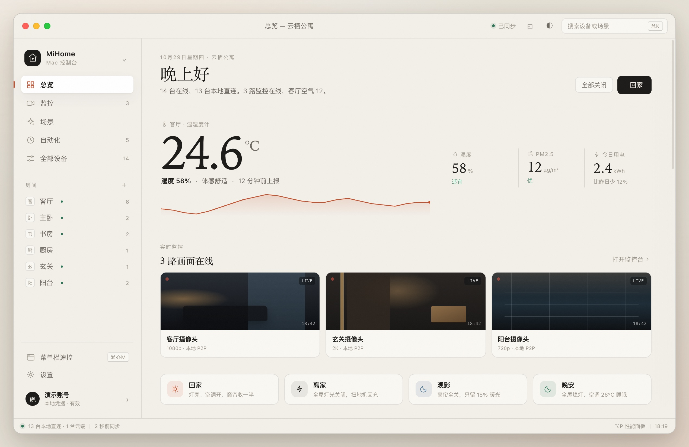
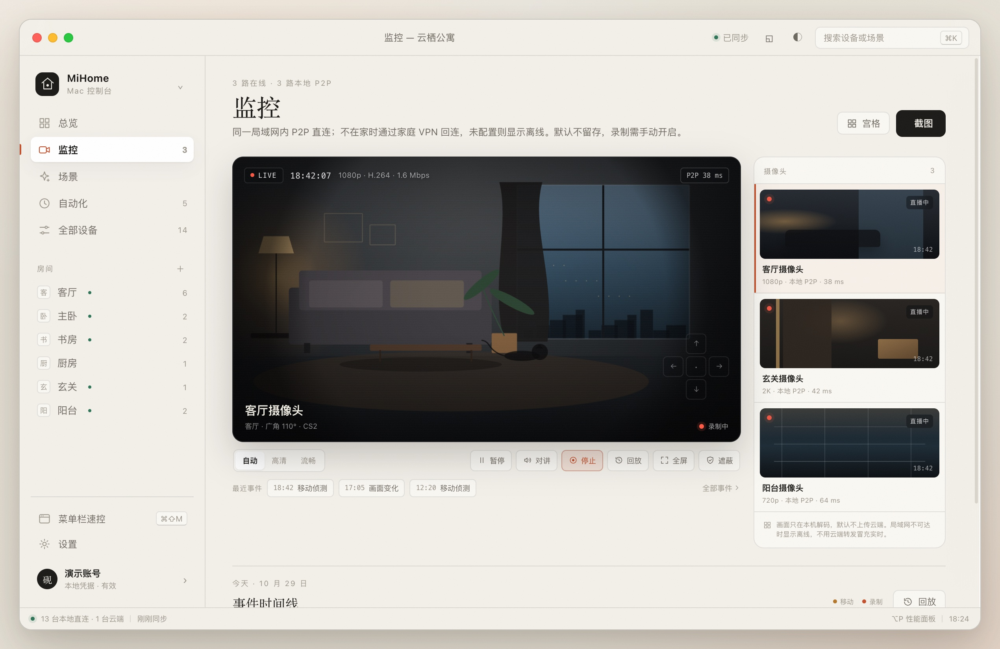
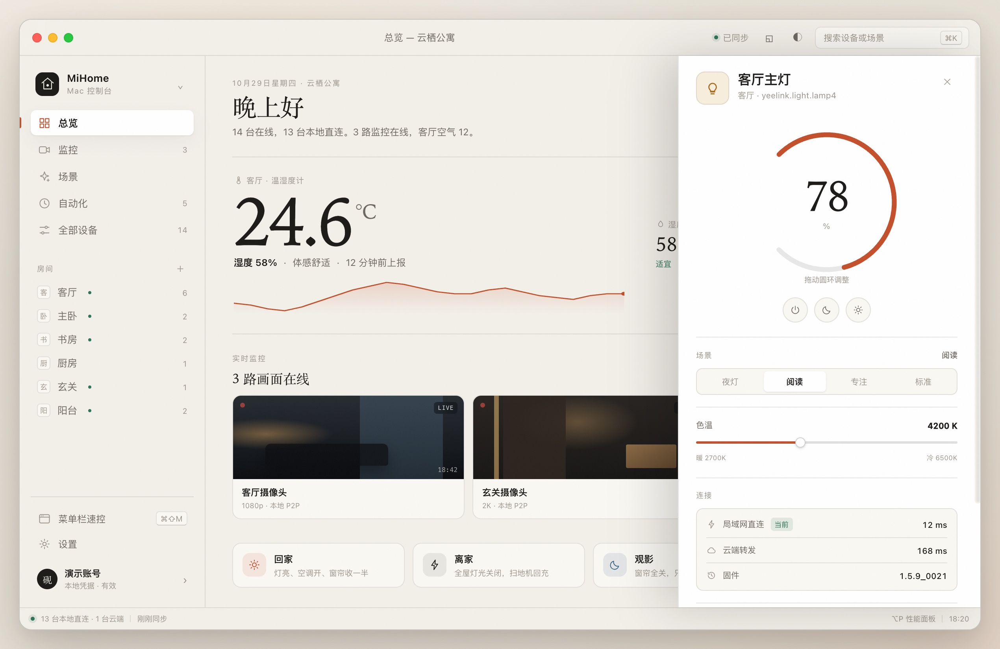

# MiHome Mac

米家设备的 macOS 桌面控制端方案：两个开源仓库的分析、可行性判断、可交互原型和技术选型。第一版范围包含设备控制、场景、局域网直连与摄像头实时查看。

原型不连接真实账号，打开就能点；摄像头画面是 canvas 模拟，不拉真实视频流。真实设备控制、局域网直连、登录流程和摄像头取流都在文档里单独说明。

“MiHome Mac”是内部代号。正式发布前需改名并做商标检索，原因见 [许可证与合规](docs/01-repo-analysis.md#七许可证与合规)。



## 结论

| 问题 | 结论 |
|---|---|
| 能不能做 | 能做。扫码登录、家庭与房间、设备列表、属性读写、场景执行都有可用接口；二维码登录端点已实测可达并返回有效二维码 |
| 能不能直接复用代码 | 不能。`mijia-api` 与 `MiHome-Windows` 都是 GPL-3.0；`ha_xiaomi_home` 只允许在 Home Assistant 内非商业使用。闭源分发需要按协议重写，开源分发可以移植 |
| 性能是不是问题 | 不是主要问题。120 台设备、1.7 MB 协议数据的本机微基准里，Swift 解码 23.77 ms、常驻内存 14.9 MB；真实瓶颈在设备适配、轮询频率和局域网 Token，不在语言 |
| 推荐技术栈 | Rust core + Tauri 2 壳，复用现有前端；Rust core 不依赖 Tauri，后续可换 SwiftUI 壳。对照方案与内存测量见 [底座选择](docs/05-rust-base.md) |
| 摄像头能不能看 | 能，但要单独做取流模块。两个仓库都不含摄像头视频；局域网用 MIT 许可的 go2rtc，远程 CS2 relay 已由 Rust 实现并在 App 内出真实 HEVC 画面；micam 只用于早期验证，不随包发布 |
| 最大风险 | 非官方接口会变；不同型号的可写属性差异大；云端没有设备状态推送，只能轮询；局域网控制需要额外拿设备 Token 和 localip；摄像头型号覆盖与 P2P 兼容性需要逐台验证 |

完整论证见 [仓库与协议分析](docs/01-repo-analysis.md)，产品与架构见 [产品设计](docs/02-product-design.md)，早期选型与实施见 [技术栈](docs/03-tech-stack.md)，摄像头取流见 [摄像头设计](docs/04-camera-design.md)，Rust 底座决策见 [底座选择](docs/05-rust-base.md)。

## 原型





快速开始：

```bash
git clone https://github.com/Reign9201/mihome-mac.git
cd mihome-mac
open prototype/index.html
```

也可以起一个本地静态服务：

```bash
cd prototype
python3 -m http.server 8899
# http://127.0.0.1:8899
```

原型是纯静态 HTML/CSS/JS，没有构建步骤、没有外部依赖、不会发出网络请求。

可以操作的内容：

- 扫码登录页：演示二维码、120 秒倒计时、模拟扫码、直接进入演示
- 总览：14 台设备、实时监控横条、房间切换、设备开关、亮度与色温、空调温度步进、场景执行、全部关闭、回家
- 监控页：3 路摄像头、主画面、宫格、云台、对讲、录制、截图、回放事件、隐私遮蔽；画面为 canvas 模拟
- 设备检查器：圆环调亮度、模式切换、色温滑块、连接路径与最近事件
- 场景页：4 个场景卡片，点击运行并回写“刚刚运行”
- 自动化页：5 条本地定时，可启停
- 全部设备页：按连接方式、开关状态筛选，按名称或型号搜索
- 设置页：明暗主题、列表密度、强调色、局域网优先、轮询间隔、诊断日志导出
- 菜单栏速控：点侧栏“菜单栏速控”打开
- 命令面板：`⌘K`，搜索设备、场景和页面
- 性能面板：`⌥P`，显示启动、内存、局域网往返等指标；数值是演示数据，不是真实测量

快捷键：`⌘1`–`⌘5` 切换总览、监控、场景、自动化、全部设备，`⌘K` 命令面板，`⌘⇧M` 菜单栏速控，`⌥P` 性能面板，`Esc` 关闭面板或检查器，`⌘,` 设置。

## 关键数字

| 项目 | 数值 | 来源 |
|---|---:|---|
| 两个主仓库代码量 | 36,386 行 Python | `mijia-api` 2,481 行 + `MiHome-Windows` 33,905 行 |
| 对照项目 `ha_xiaomi_home` | 18,820 行 Python | 只作协议参考，许可证不允许复用 |
| 120 台设备、每台 40 条属性的 JSON | 1,743.9 KiB | `benchmarks/gen_data.py` 生成 |
| Swift 解码同份数据 | 23.77 ms | 本机微基准，M4 / 32 GB |
| Rust 解码同份数据 | 1.70 ms | 同上 |
| 云端批量读写上限 | 20 条属性/请求 | `MiHome-Windows` 的 `_BATCH_SIZE = 20` |
| 现成 Windows 客户端的轮询 | 3 秒一次 | `_POLL_INTERVAL_MS = 3_000` |
| 本机访问 `api.mijia.tech` 的 TTFB | 119–209 ms | 三次 curl，未带登录态，返回 403 |

## 桌面端 M1/M2/M3

M1/M2/M3 的 Tauri 2 壳在 [`desktop/`](desktop/)，加载 [`desktop/ui/`](desktop/ui/)；[`core/`](core/) 是 Rust 协议层，已接扫码登录、家庭列表、设备列表、属性读写、go2rtc 摄像头取流和手动场景执行。运行：

```bash
cd desktop/src-tauri
cargo run
```

启动后应用会自动申请二维码，用米家 App 扫码。M1 已用真实账号验证：家庭、15 台设备、房间归属、开关读写都正常。设备页是卡片网格，显示设备名、房间和在线状态，图标按设备类型区分。

摄像头页支持本地与远程两种通道。本地走 go2rtc，只在 Mac 与摄像头同网时可用；远程走 Rust 的 CS2 relay + MISS 实现，已在 Mac 与摄像头不同网段的情况下拉出真实 HEVC 画面，并在页面内加入 14 项画面控制、两路远程宫格；云台方向盘已接实验命令，但真实位移还没确认。两路同时播放时物理内存约 104MB，构建产物不依赖 Java；ffmpeg 仍是外部依赖。

手动场景在“场景”页读取和执行；定时自动化在“自动化”页保存，应用每 30 秒检查一次；DMG 已生成在 `dist/MiHome-Mac-0.1.0-aarch64.dmg`（ad-hoc，未公证）；菜单栏尚未完成。底座选择、内存测量和性能门禁写在 [`docs/05-rust-base.md`](docs/05-rust-base.md)。

## 目录

```
MiJia/
├── README.md
├── docs/
│   ├── 01-repo-analysis.md      仓库、协议、能力边界、性能与许可证
│   ├── 02-product-design.md     产品结构、交互、视觉、架构与性能预算
│   ├── 03-tech-stack.md         候选方案、基准、推荐栈与六周实施计划
│   ├── 04-camera-design.md      摄像头取流、页面、状态与支持边界
│   ├── 05-rust-base.md          Rust/Tauri 底座、内存测量与性能门禁
│   ├── 06-camera-product-channel.md 摄像头产品通道与 CS2/MISS 移植设计
│   └── assets/                  原型截图
├── core/                        Rust 协议层：认证、签名、家庭、设备、属性
├── desktop/                     Tauri 2 壳与 M1 实机界面
├── prototype/
│   ├── index.html
│   ├── app.css
│   ├── app.js
│   ├── data.js                  演示数据：3 个家庭、14 台设备
│   └── icons.js                 线性图标
└── benchmarks/
    ├── gen_data.py              生成 120 台设备的测试数据
    ├── bench.swift              Swift 6.2 实现
    ├── bench.js                 Node 24 实现
    ├── bench.py                 Python 3.9 实现
    ├── rust/                     Rust 1.86 实现
    ├── run_bench.py             统一跑分与汇总
    └── results.md               结果与口径
```

## 术语说明

**mijia-api**：一个 Python 库，封装米家 App 使用的 HTTP 接口，支持扫码登录、设备列表、属性读写、场景执行和 MCP。本文指 Do1e/mijia-api。

**MiHome-Windows**：基于 mijia-api 的 Windows 桌面客户端，使用 PySide6 写界面。本文指 huanyuejue/MiHome-Windows。

**ha_xiaomi_home**：小米官方的 Home Assistant 集成，包含云端 MQTT 和局域网控制实现。许可证只允许在 Home Assistant 内使用。

**GPL-3.0**：GNU 通用公共许可证第 3 版。分发修改后的程序时，需要按同一许可证开放源代码。

**MIoT-Spec**：小米的设备功能描述规范。每个型号用一份 JSON 描述服务、属性、动作、取值范围和枚举值。

**TTFB**：Time To First Byte，从发出请求到收到响应第一个字节的时间。

**GRDB**：Swift 的 SQLite 封装库，提供迁移、查询和并发控制。

**SwiftUI**：Apple 的声明式界面框架，用来写 macOS 窗口和控件。

**Rust**：一种系统编程语言，编译为原生代码，内存占用低，常用于需要跨平台的核心库。

**go2rtc**：一个用 Go 写的流媒体网关，能把摄像头私有协议转成 HLS、WebRTC 或 RTSP。本项目只用它的 macOS 二进制作为本机取流助手。

**CS2 / TUTK**：小米摄像头使用的两种点对点连接协议。CS2 用于较新的机型，TUTK 用于部分老机型。

**P2P**：点对点连接，数据从摄像头直接到 Mac，不经过厂商服务器中转。

**HLS**：HTTP Live Streaming，苹果的流媒体格式，AVPlayer 可直接播放。
