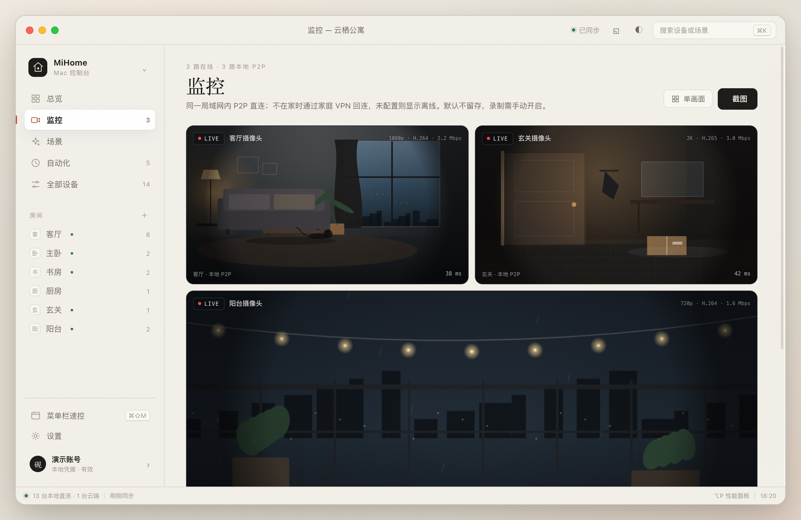
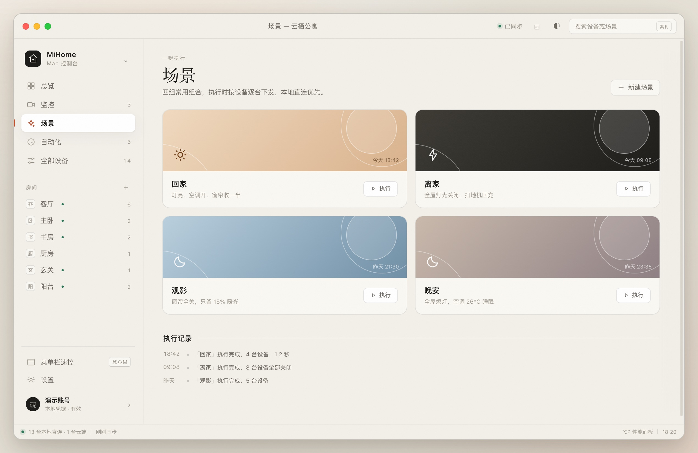
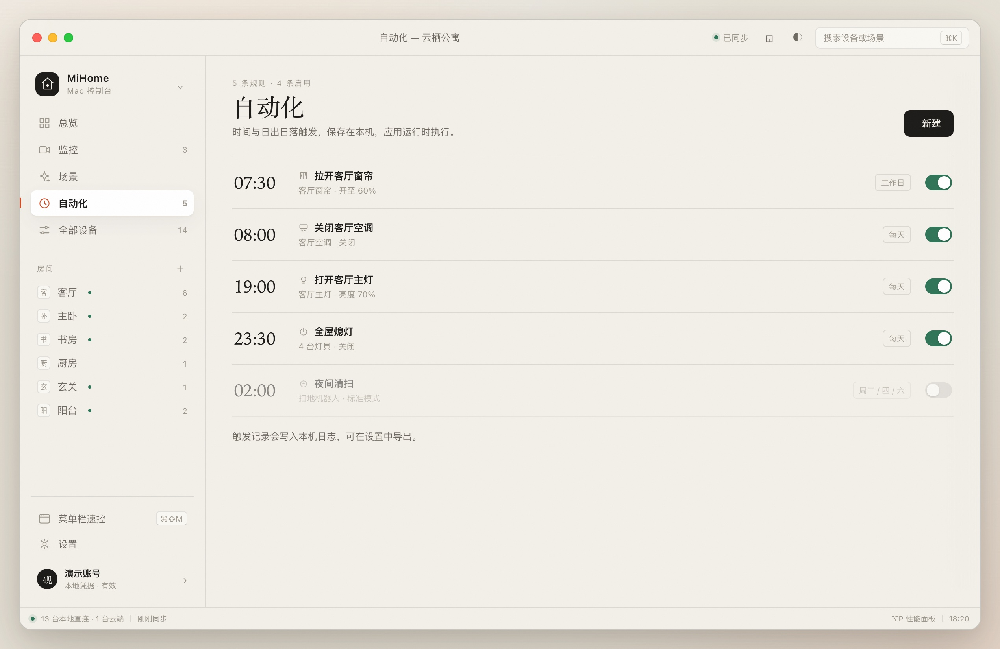
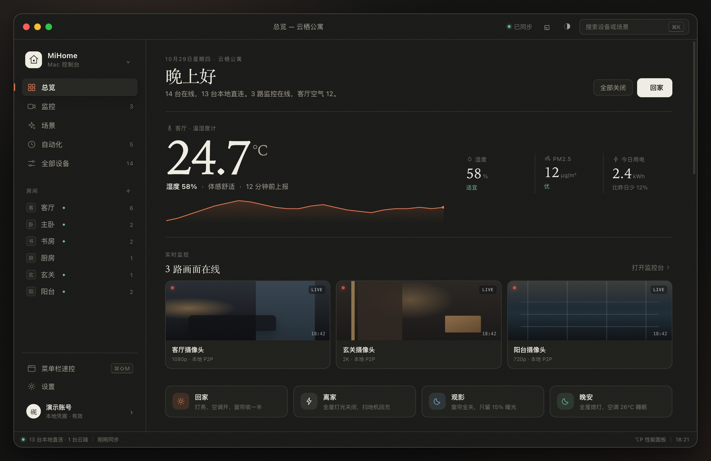

# 产品设计

本文写 MiHome Mac 的产品结构、交互规则、视觉系统、应用架构与性能预算。原型在 `prototype/`，截图在 `docs/assets/`。

“MiHome Mac”是内部代号。正式发布前要改名并做商标检索，详见 `01-repo-analysis.md` 的许可证与合规一节。

## 一、产品定位

### 1.1 一句话

把米家设备放到 Mac 的常驻位置：菜单栏一眼看状态，主窗口一次控制全屋，摄像头随时看，局域网可用时不走云端。

### 1.2 目标用户

- 家里有 5–50 台米家设备，日常用 Mac 办公。
- 不想每次都掏手机解锁、打开米家 App。
- 在意响应速度，愿意为局域网直连多花一次配置。
- 能接受非官方客户端，知道接口可能变化。

### 1.3 不服务的场景

- 摄像头的云端录像回放与固件升级。实时画面已纳入第一版；云端录像依赖小米云服务，第一版不接。
- 扫地机地图编辑。协议私有，型号差异大。
- 固件升级。失败代价高，没有官方回滚接口。
- 全屋自动化编排。米家云端不开放自动化创建接口，本地定时无法覆盖“设备状态触发”的全部情况。
- 多用户权限管理。家庭共享只做只读展示，不做权限分级。

### 1.4 产品原则

1. **常用动作不超过两次点击。** 开灯、调温、执行场景都在主窗口完成，不强迫进详情页。
2. **状态必须可解释。** 显示“本地 12 ms”还是“云端 168 ms”，显示最后一次上报时间；离线设备不显示可操作控件。
3. **本地优先，云端兜底。** 同一设备同时可用时先走局域网，失败后自动回退云端，并在界面上标明当前路径。
4. **不假装有实时推送。** 云端模式明确显示轮询间隔；局域网订阅可用时才显示“实时”。
5. **失败要给出下一步。** 权限、Token 过期、规格缺失、设备离线分别给不同文案和操作，不统一写“操作失败”。
6. **不复制米家 App。** 米家 App 是手机触控界面，Mac 版应利用键盘、菜单栏、多窗口和大屏，不把手机布局放大。

## 二、信息结构

### 2.1 一级导航

| 导航 | 内容 | 默认快捷键 |
|---|---|---|
| 总览 | 当前房间的设备、环境读数、实时监控、场景快捷入口 | `⌘1` |
| 监控 | 摄像头实时画面、宫格、云台、事件时间线 | `⌘2` |
| 场景 | 手动场景卡片与执行记录 | `⌘3` |
| 自动化 | 本地定时任务，可启停 | `⌘4` |
| 全部设备 | 全屋设备表，按房间与状态筛选 | `⌘5` |
| 设置 | 外观、连接、菜单栏、数据 | `⌘,` |
| 房间 | 侧栏二级入口，点击后总览只看该房间 | 无 |

侧栏顺序固定：品牌与家庭切换 → 五个一级入口 → 房间列表 → 菜单栏速控 / 设置 / 账号。

### 2.2 窗口结构

```
┌──────────────────────────────────────────────────────────────────────┐
│ ● ● ●        云栖公寓          ● 已同步  ◱  ◐  [搜索设备或场景 ⌘K] │ 46
├────────────┬───────────────────────────────────────┬─────────────────┤
│ 品牌        │ 主内容                                │ 检查器           │
│ 总览        │ 标题 / 环境读数 / 场景 / 房间设备      │ 设备名           │
│ 场景        │                                       │ 圆环或滑块        │
│ 自动化      │                                       │ 模式与参数        │
│ 全部设备    │                                       │ 连接路径          │
│             │                                       │ 最近事件          │
│ 房间        │                                       │                 │
│ 客厅 5      │                                       │                 │
│ 主卧 2      │                                       │                 │
│             │                                       │                 │
│ 菜单栏速控  │                                       │                 │
│ 设置        │                                       │                 │
│ 账号        │                                       │                 │
├────────────┴───────────────────────────────────────┴─────────────────┤
│ ● 13 台本地直连 · 1 台云端   2 秒前同步        ⌥P 性能面板   18:10   │ 28
└──────────────────────────────────────────────────────────────────────┘
```

尺寸：

| 区域 | 尺寸 | 说明 |
|---|---:|---|
| 标题栏 | 46 pt | 透明标题栏，红黄绿按钮左置，中间显示当前家庭 |
| 侧栏 | 236 pt | 可折叠到 68 pt，只留图标 |
| 主内容 | 自适应，最小 620 pt | 最大阅读宽度 980 pt，超出后留白 |
| 检查器 | 384 pt | 选中设备时滑出，`Esc` 关闭 |
| 状态栏 | 28 pt | 连接路径、同步时间、性能面板入口、时钟 |
| 窗口最小 | 1080 × 720 | 低于此宽度检查器改为覆盖层 |
| 默认窗口 | 1440 × 900 | 首次启动按屏幕 80% 计算，居中 |

### 2.3 页面清单

| 页面 | 必须有的内容 | 不该有的内容 |
|---|---|---|
| 登录 | 二维码、倒计时、扫码状态、隐私说明、演示入口 | 账号密码输入框、手机号输入框 |
| 总览 | 当前房间、环境读数、实时监控横条、4 个场景、房间设备列表 | 全屋 120 台设备的长列表 |
| 监控 | 实时画面、宫格、云台、对讲、录制、截图、事件时间线 | 云端录像库、摄像头设置 |
| 场景 | 场景卡片、最近执行时间、失败设备数 | 场景编辑器（云端不支持） |
| 自动化 | 时间、目标、星期、启停开关 | 云端同步状态（本地任务没有云端状态） |
| 全部设备 | 搜索、房间筛选、在线筛选、批量开关 | 每台设备的完整详情 |
| 设置 | 主题、密度、强调色、连接策略、缓存、日志 | 账号密码、家庭管理 |
| 设备检查器 | 主控制、模式、参数、连接路径、最近事件 | 与设备无关的推荐内容 |

## 三、总览页

### 3.1 结构

1. **页头**：日期、当前家庭、问候语。问候语按本地时间变化：5–11 点“早上好”，11–14 点“中午好”，14–18 点“下午好”，其余“晚上好”。
2. **环境读数**：取当前房间里优先级最高的传感器。温度用 88–112 pt 衬线数字，湿度、PM2.5、今日用电三项并排。温度下方给 24 小时折线，只画趋势，不加坐标轴。
3. **实时监控**：3 路摄像头缩略图横条，显示实时状态、分辨率与连接路径；点击进入监控页，右侧“打开监控台”进入完整页面。
4. **场景横条**：4 个场景按钮，图标 + 名称 + 一句动作摘要。宽度均分，窄窗口可横向滚动。
5. **房间设备**：按房间分组，每行一台设备。行内含名称、型号或状态摘要、连接标签、主要控制、更多菜单。
6. **全屋摘要**：页面底部一行“14 台在线 · 今日用电 2.4 kWh”，点击进入全部设备。

### 3.2 设备行规则

| 设备类型 | 行内主控制 | 行内次信息 |
|---|---|---|
| 灯 | 亮度滑块 + 开关 | 色温、模式 |
| 空调 | 温度步进 + 开关 | 模式、风速、室内温度 |
| 窗帘 | 开合百分比 + 开关 | 运行状态 |
| 净化器 | 开关 | PM2.5、滤芯剩余 |
| 温湿度计 | 无 | 温度、湿度、电量 |
| 加湿器 | 开关 | 目标湿度、水箱 |
| 插座 | 开关 | 功率、今日用电 |
| 扫地机 | 开关 | 状态、电量、上次清扫 |
| 摄像头 | “查看”按钮 | 直播状态、分辨率、延迟 |
| 传感器 | 无 | 读数、最后上报 |

规则：

- 不可写属性只显示数值，不显示禁用控件。
- 离线设备整行降透明度，开关替换为“离线”标签，点击行仍可看最后一次状态。
- 无公开规格的设备显示“无公开规格”，点击打开说明页，不显示空白检查器。
- 滑动条拖动时只改本地显示，松手后提交；提交中显示细进度条，不锁住其他设备。
- 同一设备连续操作合并：1.2 秒内只发最后一次值。

### 3.3 房间切换

- 点击侧栏房间，主内容切到该房间，页头显示“客厅 · 5 台”。
- 再次点击同一房间回到全屋。
- 房间切换只换数据源，不重建窗口和滚动容器。
- 切换后保留滚动位置到该房间上次的位置，按房间记在内存里。

### 3.4 全部关闭与回家

页头右侧放两个高频动作：

- **全部关闭**：关闭当前房间（或全屋）所有可写开关设备，执行前弹出确认，列出将受影响的设备数。
- **回家**：执行“回家”场景。场景执行中按钮显示进度，失败设备数在按钮下方一行显示。

### 3.5 监控页

监控页单独成章，画面布局、云台、对讲、录制、事件时间线与取流边界见 [摄像头设计](04-camera-design.md)。总览只保留 3 路缩略图，不放大段文字说明；用户点缩略图直接进入对应摄像头的单画面。

## 四、设备检查器

### 4.1 打开与关闭

- 点击设备行任意位置打开，右侧 384 pt 滑出，主内容宽度相应收缩。
- 窗口宽度小于 1200 pt 时，检查器改为覆盖层，背景加 8% 遮罩。
- `Esc`、点击遮罩、点击关闭按钮都能关闭。
- 切换页面时自动关闭，避免检查器与页面内容不匹配。

### 4.2 内容顺序

1. 设备图标、名称、房间、在线状态。
2. 主控制：灯用亮度圆环，空调用温度圆环，窗帘用开合滑块，其他设备用开关。
3. 模式切换：台灯阅读/工作/睡眠，空调制冷/除湿/送风/制热，净化器自动/睡眠/最爱。
4. 参数控制：亮度预设、色温滑块、风速、扫风、目标湿度。
5. 连接路径：本地或云端、最近一次往返耗时、协议、最后上报时间。
6. 最近事件：最近 5 条，包含时间、动作、结果。
7. 更多：重命名、查看规格、复制诊断信息。

### 4.3 圆环控制

- 直径 190 pt，270° 圆弧，底部留 90° 缺口。
- 拖动时数值实时更新，圆环外圈显示刻度，内圈显示大号数字与单位。
- 键盘左右键步进：亮度 1%，温度 0.5 °C，窗帘 5%。
- 松手后提交；提交中内圈显示细环，不改数字。
- 达到最小值或最大值时圆环端点变实心，给出触觉反馈（Mac 触控板用 `NSHapticFeedbackManager`）。

### 4.4 状态与错误

| 状态 | 显示 | 可执行操作 |
|---|---|---|
| 在线，本地 | 绿色点 + “本地 12 ms” | 全部控制 |
| 在线，云端 | 蓝色点 + “云端 168 ms” | 全部控制 |
| 弱网 | 黄色点 + “云端 1.2 s” | 控制，提示可能延迟 |
| 离线 | 灰色点 + “最后在线 18 分钟前” | 只读，禁用控制 |
| Token 过期 | 顶部横幅 + “重新登录” | 重新扫码 |
| 规格缺失 | “无公开规格”说明 | 查看设备信息，无控制 |
| 设备报错 | 错误码 + 一句解释 | 重试、复制诊断信息 |
| 请求超时 | “设备未响应” | 重试、切换云端 |

错误码不直接展示给普通用户，放在“复制诊断信息”里；界面只显示一句人话和下一步。

## 五、场景页

### 5.1 卡片

每个场景一张卡，2×2 网格，宽屏 4 列。卡片包含：

- 场景名与图标。
- 一句动作摘要，由场景内设备动作自动生成，例如“4 台设备 · 灯光 2 · 空调 1 · 窗帘 1”。
- 最近执行时间与结果。
- 右下角“运行”按钮。

不使用大图背景，不为每个场景生成插画。颜色只用来区分场景气质：回家暖橙、离家墨黑、观影靛蓝、晚安深蓝。

### 5.2 执行

场景执行是逐台下发，不是云端单次调用：

1. 读取场景内设备的目标属性。
2. 按“本地优先、云端兜底”排序。
3. 并发上限 4 台，逐台提交。
4. 每台成功即更新本地状态，不等待全部完成。
5. 结束后显示“4 台成功，1 台失败”，失败的设备可展开重试。

米家云端场景接口只能执行已在米家 App 建好的场景；本页也可以展示这些场景，但不在 Mac 里创建或编辑。

### 5.3 本地场景

本地场景是 Mac 自己的设备组合，存在本机 SQLite，不写回米家。首次启动时根据常用设备生成 3 个建议场景，用户确认后才保存。

## 六、自动化页

### 6.1 能力边界

米家云端不提供自动化创建接口。自动化页只做本地定时：

- 时间触发：每天、工作日、自定义星期。
- 日出日落触发：按所在城市计算，允许 ±60 分钟偏移。
- 设备状态触发：仅在局域网订阅可用时生效，第一版不做。

页面顶部明确写“本地定时，需要应用保持运行”。不写“云端同步”，避免用户误以为关掉 Mac 也会执行。

### 6.2 列表

每行依次是：时间、名称、目标摘要、星期、开关。

- 时间用衬线数字，左侧固定宽度，便于扫读。
- 关闭的任务整行降到 55% 透明度，时间加删除线。
- 点击行打开编辑弹层；开关独立，不触发编辑。
- 新建按钮在页头右侧，键盘 `⌘N` 等效。

### 6.3 错过与失败

- Mac 睡眠或退出期间错过的任务不补执行，恢复后只在日志里记一条“已错过”。
- 执行失败时保留在列表，标红一次，下一次成功自动清除。
- 日志保留 30 天，设置页可导出 CSV。

## 七、全部设备页

### 7.1 表格

列：设备、房间、状态、连接、主要读数、最后上报、开关。

- 行高 44 pt（宽松）或 36 pt（紧凑）。
- 表头吸顶，滚动时保持可见。
- 列宽用户可拖，保存在本机。
- 默认按房间排序，同房间按名称排序；支持点表头改为按状态或最后上报排序。

### 7.2 筛选

顶部一行：搜索框、房间下拉、在线状态分段控件、批量操作。

- 搜索匹配设备名、型号、房间名和别名。
- 多选后底部出现操作条：全部开启、全部关闭、加入场景。
- 120 台设备时列表要能保持 60 fps 滚动；1000 台时首屏不超过 200 ms。

### 7.3 空状态

- 没有设备：“这个家庭还没有设备。先在米家 App 添加，再回到这里刷新。”
- 搜索无结果：“没有匹配‘书房’的设备。”清空搜索按钮。
- 全部离线：“设备都离线了。检查 Wi-Fi 或路由器后重试。”重试按钮。

## 八、菜单栏与小组件

### 8.1 菜单栏速控

点击菜单栏图标弹出 320 pt 宽的浮层：

- 顶部：家庭名、在线设备数、同步时间。
- 常用设备：最多 6 台，开关与温度步进可直接操作。
- 场景：最近使用的 4 个场景。
- 底部：打开主窗口、设置、退出。

规则：

- 浮层不抢焦点，点外部自动关闭。
- 设备操作后有 1.5 秒的成功提示，不弹系统通知。
- 失败时浮层内显示红色一行，不自动关闭，方便重试。
- 菜单栏图标在深浅色菜单栏都清晰，使用模板图像。

### 8.2 桌面小组件

- 小尺寸：当前房间温度、湿度、2 台常用设备开关。
- 中尺寸：4 台设备 + 2 个场景。
- 大尺寸：环境趋势 + 6 台设备 + 4 个场景。

小组件不能直接发网络请求，数据由主 App 写入 App Group 的共享容器，小组件只读。点击设备跳到主窗口对应检查器。

### 8.3 快捷指令

提供三个 App Intents：

- “打开/关闭设备”，参数是设备名。
- “执行场景”，参数是场景名。
- “读取房间温度”，返回数值。

## 九、设置页

### 9.1 分组

| 分组 | 项 | 默认值 |
|---|---|---|
| 外观 | 主题：跟随系统 / 浅色 / 深色 | 跟随系统 |
| 外观 | 列表密度：宽松 / 紧凑 | 宽松 |
| 外观 | 强调色：柿红 / 苔绿 / 靛青 | 柿红 |
| 连接 | 局域网直连优先 | 开 |
| 连接 | 自动发现设备（mDNS） | 开 |
| 连接 | 云端刷新间隔：3 / 5 / 10 秒 | 5 秒 |
| 菜单栏 | 显示菜单栏图标 | 开 |
| 菜单栏 | 快捷键 | `⌘⇧M` / `⌘K` |
| 数据 | 本机缓存大小与清除 | — |
| 数据 | 诊断日志导出 | — |
| 数据 | 版本与架构 | — |
| 账号 | 当前账号、登录状态、退出登录 | — |

### 9.2 危险操作

- 清除缓存：只清设备列表、规格与图标，不清凭据与自动化；二次确认。
- 退出登录：清 Keychain、Token、设备缓存；保留诊断日志；二次确认，文案说明退出后无法控制设备。
- 删除家庭数据：第一版不提供，避免误删。

## 十、视觉系统

### 10.1 方向

“晨昏仪表盘”：暖纸底色、近黑墨色、柿红强调色，细线分区，少量大号衬线数字。它看起来像一本放在桌上的家居手册，不像一块发光的数据大屏。

浅色主题用于白天，深色主题“夜巡”用深蓝黑与暖橙，不用纯黑。

### 10.2 颜色

| 名称 | 浅色 | 深色 | 用途 |
|---|---|---|---|
| paper | `#f4f0e7` | `#15181b` | 窗口底色 |
| surface | `#fbf8f1` | `#1c2024` | 主内容与浮层 |
| ink | `#1b1a17` | `#efe9dc` | 主文字 |
| muted | `#6f6a60` | `#9a958a` | 次要文字 |
| line | `#ded7c8` | `#2e343a` | 分隔线 |
| accent | `#c44f2b` | `#e5744a` | 按钮、开关、图表 |
| sage | `#4c6b52` | `#7e9b84` | 在线、成功 |
| amber | `#b4832f` | `#d8a85a` | 警告、弱网 |
| danger | `#a63d33` | `#d96a5f` | 错误、危险操作 |

强调色提供三套，切换时只改 `--accent`，不改语义色。图表使用强调色的 60% 透明度作为面积填充，线宽 1.5 pt。

### 10.3 字体

| 用途 | 字体 | 字号 | 字重 |
|---|---|---|---|
| 大号读数 | New York / Songti SC | 88–112 pt | Regular |
| 页面标题 | New York / Songti SC | 40 pt | Regular |
| 设备名 | PingFang SC / SF Pro | 13 pt | Medium |
| 正文 | PingFang SC / SF Pro | 13 pt | Regular |
| 次要信息 | PingFang SC / SF Pro | 11 pt | Regular |
| 数字与时间 | SF Mono / Menlo | 12 pt | Regular |
| 按钮 | PingFang SC / SF Pro | 12 pt | Medium |

系统没有 New York 时回退到 Songti SC，再回退到系统衬线体。中文界面不强行使用西文衬线字体，避免中英文混排断裂。

### 10.4 间距与形状

- 8 pt 网格；常用的间距是 8、12、16、24、32、48。
- 圆角：窗口 16 pt，面板 14 pt，输入框 8 pt，开关 11 pt。
- 分隔线 1 px，颜色用 `line`，不用阴影代替。
- 阴影只用于浮层和菜单栏面板，窗口本体不加外阴影。
- 卡片最多两层：页面底色 + 一个面板色；不在卡片里再套卡片。

### 10.5 图标

- 线性图标，1.5 pt 描边，24×24 画布，圆角端点。
- 设备图标按品类区分：灯、空调、窗帘、净化器、传感器、加湿器、插座、扫地机。
- 在线状态用 6 pt 圆点，不用彩色边框。
- 图标不写实、不拟物，不用米家官方图标。

### 10.6 动效

| 场景 | 时长 | 曲线 |
|---|---:|---|
| 页面切换 | 180 ms | ease-out |
| 检查器滑出 | 240 ms | cubic-bezier(0.22, 1, 0.36, 1) |
| 开关状态 | 160 ms | ease |
| 圆环数值 | 120 ms | linear |
| Toast 出现 | 220 ms | spring，阻尼 0.82 |
| 场景执行进度 | 按实际进度 | linear |

开启“减少动态效果”后，位移改为淡入淡出，弹簧改为线性，进度环保留。

### 10.7 界面示例

| 监控 | 宫格 |
|---|---|
|  |  |
| **登录** | **场景** |
|  |  |
| **自动化** | **深色主题** |
|  |  |

## 十一、应用架构

### 11.1 分层

```
MiHomeMacApp
├── App
│   ├── MiHomeMacApp.swift          窗口、菜单栏、快捷指令
│   ├── AppEnvironment.swift        依赖装配、启动阶段
│   └── Commands.swift              菜单与快捷键
├── UI
│   ├── Overview/                   总览、房间设备列表
│   ├── Scenes/                     场景卡片与执行结果
│   ├── Automations/                定时任务
│   ├── Devices/                    全部设备表
│   ├── Camera/                     监控、宫格、云台、时间线
│   ├── Inspector/                  设备检查器与各类控件
│   ├── Settings/                   设置
│   ├── Login/                      扫码登录
│   └── Components/                 开关、滑块、圆环、标签、空状态
├── Domain
│   ├── DeviceRegistry.swift        家庭、房间、设备索引
│   ├── Capability.swift            规格到控件的映射
│   ├── CommandService.swift        写入队列、合并、乐观更新
│   ├── SceneRunner.swift           场景逐台执行
│   ├── AutomationEngine.swift      本地定时
│   ├── CameraSession.swift         取流状态、重连、录制控制
│   └── Diagnostics.swift           事件与耗时
├── Data
│   ├── CloudClient.swift           HTTP、签名、批量属性
│   ├── LANClient.swift             UDP 54321、AES、订阅
│   ├── CameraService.swift         go2rtc helper 生命周期与本地 URL
│   ├── SpecRepository.swift        规格缓存与解析
│   ├── AuthSession.swift           Token、刷新、Keychain
│   ├── Database.swift              GRDB 迁移与查询
│   └── SettingsStore.swift         偏好与 App Group
└── Platform
    ├── MenuBarPanel.swift          菜单栏速控
    ├── WidgetBridge.swift          小组件数据写入
    └── LoginItem.swift             开机启动
```

依赖方向只能从上到下：UI 依赖 Domain，Domain 依赖 Data 的协议，Data 不引用 UI。`AppEnvironment` 负责把具体实现注入。

### 11.2 并发模型

| 组件 | 隔离方式 | 职责 |
|---|---|---|
| `AuthSession` | `actor` | 登录、Token 刷新、单飞（single-flight） |
| `CloudClient` | `actor` | 签名、请求、20 条批量、限流 |
| `LANClient` | `actor` | UDP socket、加解密、超时、重试 |
| `CameraService` | `actor` | helper 启动、停止、端口探测、崩溃重启 |
| `CameraSession` | `actor` | 连接状态、首帧、重连、录制状态 |
| `SpecRepository` | `actor` | 内存与 SQLite 缓存、同型号请求去重 |
| `DeviceStore` | `@MainActor @Observable` | 界面状态、设备行、筛选结果 |
| `CommandQueue` | `actor` | 优先级、合并、版本号、取消 |
| `PollScheduler` | `actor` | 可见设备、退避、前后台切换 |

规则：

- 所有网络与磁盘读写不在主线程。
- 界面只读 `DeviceStore`，不直接调用 `CloudClient`。
- 用户操作进 `CommandQueue`，先写本地状态并带 `generation`，响应回来后只有同代结果能覆盖。
- Token 刷新只允许一个请求在途；其他请求等待同一个 `Task`。
- 轮询请求可取消；用户操作不可取消，超时 8 秒。

### 11.3 状态流

```
用户点击
  -> CommandQueue.enqueue(intent)
  -> DeviceStore 乐观更新（generation += 1）
  -> LANClient 或 CloudClient 下发
  -> 成功：写入返回值，更新最后上报时间
  -> 失败：回滚到上一代状态，记录错误
  -> 轮询返回：只有 generation 相同才写入
```

### 11.4 启动阶段

| 阶段 | 目标 | 内容 |
|---|---:|---|
| T0 进程启动 | 150 ms | 初始化日志、读取偏好、创建窗口 |
| T1 首帧 | 400 ms | 窗口出现，显示骨架与上次缓存 |
| T2 可用 | 1,500 ms | 读取 Keychain、恢复设备缓存、启动轮询 |
| T3 实时 | 3,000 ms | 完成首次云端刷新，状态标记“已同步” |

启动时先显示缓存，再后台刷新。缓存超过 24 小时不直接显示为在线状态，标“缓存数据，正在刷新”。

### 11.5 数据模型

| 表 | 关键字段 | 说明 |
|---|---|---|
| `homes` | `id`、`name`、`uid`、`updated_at` | 家庭 |
| `rooms` | `id`、`home_id`、`name`、`sort` | 房间 |
| `devices` | `did`、`home_id`、`room_id`、`name`、`model`、`spec_type`、`online`、`local_ip`、`path` | 设备索引 |
| `device_state` | `did`、`siid`、`piid`、`value`、`updated_at` | 属性缓存，按属性一行 |
| `specs` | `spec_type`、`json`、`fetched_at` | 规格缓存 |
| `scenes` | `id`、`home_id`、`name`、`actions_json`、`last_run` | 本地场景 |
| `automations` | `id`、`time`、`days`、`actions_json`、`enabled` | 本地定时 |
| `events` | `id`、`did`、`kind`、`result`、`latency_ms`、`created_at` | 诊断事件，30 天 |
| `metrics` | `did`、`key`、`value`、`ts` | 读数曲线，按小时聚合 |

凭据不进 SQLite。`serviceToken`、`passToken`、`ssecurity`、设备 `token` 都放 Keychain，按家庭和账号加前缀。

### 11.6 请求策略

| 请求 | 并发上限 | 批量 | 超时 | 重试 |
|---|---:|---:|---:|---|
| 设备列表 | 1 | 200 条/页 | 10 s | 2 次，指数退避 |
| 属性读 | 4 | 20 条/批 | 8 s | 2 次 |
| 属性写 | 4 | 10 条/批 | 8 s | 1 次，仅在明确超时后 |
| 动作 | 2 | 单条 | 10 s | 1 次 |
| 规格 | 6 | 单个型号 | 10 s | 2 次 |
| 局域网 | 1 个 socket | 单设备 | 200 ms | 3 次，间隔 50 ms |

写入不轻易重试：设备可能已经执行，重试会造成重复动作。只有连接建立失败或明确超时才重试一次。

### 11.7 轮询策略

| 场景 | 本地设备 | 云端设备 |
|---|---:|---:|
| 窗口在前台，设备可见 | 3 s | 5 s |
| 窗口在前台，设备不可见 | 15 s | 30 s |
| 窗口隐藏 | 30 s | 60 s |
| 屏幕锁定 | 暂停 | 暂停 |
| 低电量模式 | 15 s | 30 s |
| 网络断开 | 停止，等待网络恢复 | 停止 |

轮询只覆盖可见设备、菜单栏常用设备和小组件跟踪设备。120 台设备全部轮询会触发云端限流，不做。

### 11.8 局域网优先

```
设备在线
  -> 有 local_ip 与 token？
      否 -> 云端
      是 -> UDP 握手 200 ms
              成功 -> 本地路径，订阅属性
              失败 -> 记一次失败，30 秒内不再尝试 -> 云端
  -> 本地连续失败 3 次 -> 降级云端，菜单显示原因
```

网络切换（Wi-Fi 变更、睡眠唤醒）时清空 `local_ip` 缓存并重新发现。不把 `local_ip` 写死到数据库长期使用。

### 11.9 权限与沙盒

| 权限 | 用途 | 触发时机 |
|---|---|---|
| 局域网 | UDP 54321 与 mDNS 发现 | 首次启用本地直连 |
| 通知 | 自动化执行结果、Token 过期 | 首次开启通知 |
| 登录项 | 开机启动 | 设置页手动开启 |
| 钥匙串 | 保存 Token | 首次登录 |

App Sandbox 需要 `com.apple.security.network.client` 与 `com.apple.security.network.server`（UDP 绑定）。局域网权限被拒绝时，应用仍可用云端，设置页给出“去系统设置开启”的入口。

### 11.10 更新与分发

- 开发者 ID 签名 + 公证，DMG 分发。
- Sparkle 2 做增量更新，EdDSA 签名，更新源用 HTTPS。
- 不做 Mac App Store 首发：GPL 兼容性、非官方接口、局域网权限审核都有不确定性。
- 内测用 TestFlight 不可行（macOS 也支持，但审核同样要求），改用签名 DMG + 邀请码。

## 十二、性能预算

以下是目标值，不是实测值；原型底部的性能面板是演示数据。

### 12.1 启动与内存

| 指标 | 目标 | 上限 |
|---|---:|---:|
| 进程启动到首帧 | 400 ms | 700 ms |
| 缓存恢复到可操作 | 800 ms | 1,200 ms |
| 首次云端同步完成 | 1.5 s | 3 s |
| 空闲常驻内存（14 台，不含视频） | 140 MB | 200 MB |
| 单路 1080p 硬解内存 | +60 MB | +100 MB |
| 峰值内存（120 台） | 220 MB | 300 MB |
| 空闲 CPU | 0.3% | 1% |
| 轮询时 CPU | 1.5% | 4% |
| 单路 1080p 硬解 CPU | 5% | 10% |

### 12.2 操作延迟

| 操作 | p50 | p95 |
|---|---:|---:|
| 本地开关 | 25 ms | 60 ms |
| 本地调亮度 | 30 ms | 80 ms |
| 云端开关 | 350 ms | 900 ms |
| 场景执行（4 台） | 600 ms | 1.5 s |
| 打开检查器 | 80 ms | 150 ms |
| 切换房间 | 60 ms | 120 ms |
| 搜索 120 台设备 | 16 ms | 40 ms |

### 12.3 界面

- 列表滚动 120 Hz，掉帧率低于 1%。
- 1000 台设备首屏渲染低于 200 ms。
- 图片解码与下载不在主线程；图标按型号去重，内存缓存上限 64 MB。
- 窗口缩放不重建视图；使用 SwiftUI 布局或 `NSTableView` 复用。
- 图表只画可见区间，最多 240 个采样点；长时间范围按小时聚合。

### 12.4 网络与电量

- 单次轮询请求数不超过 6 个。
- 局域网失败后 30 秒内不再尝试，避免每次操作都等 200 ms。
- 使用 `NWPathMonitor` 监听网络变化，网络恢复后延迟 2 秒再刷新。
- 定时器使用 10% 容差，减少唤醒次数。
- 低电量模式自动降低轮询频率，并在状态栏显示“省电模式”。

## 十三、错误与边界

### 13.1 错误分类

| 类型 | 例子 | 界面处理 |
|---|---|---|
| 网络 | 无法连接、超时 | 顶部横幅，自动重试，保留缓存 |
| 认证 | Token 过期、账号退出 | 全屏登录，说明原因 |
| 权限 | 局域网被拒 | 设置页入口，云端继续可用 |
| 接口 | 429、服务不可用 | 退避，状态栏显示“云端繁忙” |
| 设备 | 离线、执行失败、错误码 | 行内提示，检查器给重试 |
| 数据 | 规格缺失、属性不支持 | 说明页，不显示控件 |
| 本机 | 磁盘满、数据库损坏 | 提示导出日志，提供重建缓存 |

### 13.2 离线与缓存

- 离线时显示上次状态，标注“最后在线 X 分钟前”。
- 离线超过 24 小时不显示开关状态，只显示设备名与“长期离线”。
- 离线期间的用户操作不排队，直接提示“设备离线，未发送”。
- 网络恢复后先刷新设备列表，再刷新可见设备状态。

### 13.3 空状态与首次使用

1. 登录成功但家庭没有设备：引导去米家 App 添加，提供“刷新”。
2. 有设备但没有房间：全部归入“未分组”，允许在 Mac 上改本地房间名，不写回云端。
3. 所有设备离线：显示网络检查建议与“重新扫描局域网”。
4. 没有本地场景：显示 3 个建议场景，用户可选择保存。
5. 没有自动化：显示一条示例（工作日 08:00 关闭夜灯），可一键创建。

## 十四、可访问性与国际化

### 14.1 可访问性

- 所有图标按钮有 `accessibilityLabel`。
- 开关使用 `Toggle` 语义，读屏播报“客厅主灯，开”。
- 圆环支持键盘与 VoiceOver 调整，播报当前值与单位。
- 对比度满足 WCAG 2.1 AA：正文 4.5:1，大号数字 3:1。
- 支持“增强对比度”“减少透明度”“减少动态效果”。
- 不用颜色作为唯一状态提示，在线/离线同时有文字。
- 最小点击区域 28×28 pt，菜单栏图标 22×22 pt。

### 14.2 国际化

- 首发简体中文与英文，字符串放 String Catalog。
- 设备名、房间名用云端返回值，不做机器翻译。
- 数字、日期、时间用系统区域格式；温度单位跟随系统（°C/°F），设置页可覆盖。
- 布局为英文预留 30% 宽度，避免按钮文字截断。

## 十五、验收标准

### 15.1 功能

- [ ] 扫码登录成功，Token 过期后能自动刷新；刷新失败回到登录页并说明原因。
- [ ] 家庭、房间、设备列表与米家 App 一致；共享设备单独标记。
- [ ] 灯、空调、窗帘、净化器、插座五类设备可开关与调参。
- [ ] 场景可执行，逐台显示结果，失败可重试。
- [ ] 本地定时可创建、启停、删除；错过与失败有记录。
- [ ] 局域网可用时走本地，失败自动回退云端，界面显示当前路径。
- [ ] 菜单栏速控可开关常用设备、执行场景。
- [ ] 设置项全部生效并持久化；退出登录清空凭据。
- [ ] 监控页可看到至少 1 路真实摄像头画面；局域网首帧低于 1 秒，断流 5 秒内提示并可重连；隐私遮蔽后画面立即被遮住。

### 15.2 性能

- [ ] 14 台设备冷启动首帧低于 700 ms。
- [ ] 空闲内存低于 200 MB，120 台设备峰值低于 300 MB；单路 1080p 硬解额外不超过 100 MB。
- [ ] 本地开关 p95 低于 80 ms。
- [ ] 120 台设备列表滚动 60 fps 以上。
- [ ] 连续运行 24 小时无内存增长超过 10%。

### 15.3 稳定性

- [ ] 断网 10 分钟再恢复，状态在 5 秒内恢复。
- [ ] Token 过期、429、设备离线、规格缺失四类错误都有明确提示。
- [ ] 强制退出后重启，缓存与本地场景不丢。
- [ ] 局域网权限被拒时，云端功能全部可用。
- [ ] 睡眠唤醒后 3 秒内恢复轮询。

## 十六、开发顺序

| 阶段 | 内容 | 产出 |
|---|---|---|
| 第 1 周 | 登录、Keychain、家庭与设备列表、规格缓存 | 能看到真实设备列表 |
| 第 2 周 | 属性读、开关写、设备行与检查器 | 能控制灯与插座 |
| 第 3 周 | 场景、批量操作、错误处理、缓存 | 日常可用 |
| 第 4 周 | 局域网握手、读写、回退 | 本地直连可用 |
| 第 5 周 | 菜单栏、小组件、快捷指令、本地定时 | 常驻能力完整 |
| 第 6 周 | 性能、可访问性、签名、公证、内测 | 可分发测试版 |

详细任务拆解、风险与验证方式见 `03-tech-stack.md`。

## 术语说明

**SwiftUI**：Apple 的声明式界面框架，用状态驱动 macOS 与 iOS 界面。

**actor**：Swift 的并发隔离类型，同一时刻只允许一个任务访问它的可变状态。

**@MainActor**：Swift 的全局 actor，标记必须主线程执行的代码。

**GRDB**：Swift 的 SQLite 封装库，提供数据库迁移、查询与并发控制。

**Keychain**：macOS 的系统凭据存储，按应用和访问组隔离，适合保存 Token。

**App Sandbox**：macOS 的应用沙盒。开启后应用只能访问授权目录与网络能力。

**App Group**：同一开发者的多个应用或扩展共享数据的容器，小组件用它读主应用写入的状态。

**App Intents**：Apple 的快捷指令与系统级操作接口，让应用的动作出现在快捷指令、Spotlight 搜索和 Siri 中。

**MenuBarExtra**：SwiftUI 的菜单栏常驻入口，用来放菜单栏速控面板。

**WidgetKit**：Apple 的小组件框架，界面由时间线驱动，不能直接发网络请求。

**mDNS**：局域网内的设备发现协议，用组播查询设备提供的服务。

**NWPathMonitor**：Apple 的网络状态监听接口，用来感知 Wi-Fi、有线与断网切换。

**p50 / p95**：延迟分布的第 50 与第 95 百分位。p50 表示一半请求快于这个值，p95 表示 95% 的请求快于这个值。

**单飞（single-flight）**：多个调用同时需要同一份结果时，只发一次请求，其他调用等待同一个结果。

**乐观更新**：用户操作后先改界面，再等服务器确认；失败时回滚。
