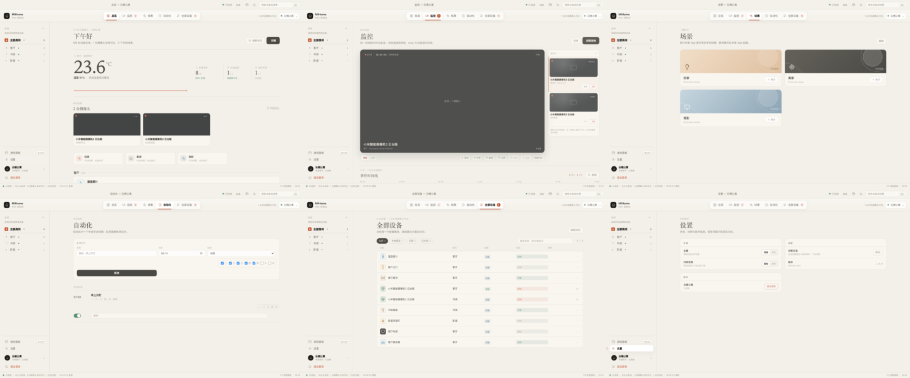
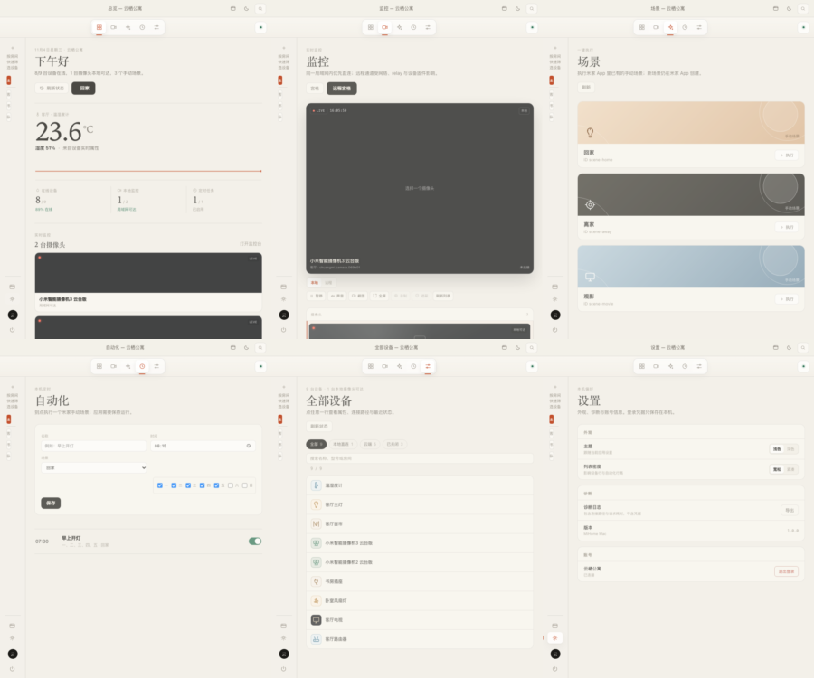

# UI 设计对齐与回归

本文记录 MiHome Mac 实际桌面应用与交互原型之间的对齐状态、验证范围、已知差异和发布素材规则。

> **状态：** 2026-11-04 已完成主要页面和交互外壳的第一轮 1:1 对齐。实际应用继续使用真实设备、场景、摄像头和自动化数据；原型演示数据不会进入正式界面。

## 一、设计与实现基线

| 基线 | 文件 | 用途 |
|---|---|---|
| 交互原型 | `prototype/index.html`、`prototype/app.css`、`prototype/app.js` | 页面结构、视觉层级、控件尺寸和动效的唯一设计源 |
| 产品规范 | `docs/02-product-design.md` | 信息架构、视觉系统、性能预算和产品边界 |
| 实际界面 | `desktop/ui/`、`docs/assets/app-*-demo.png` | 当前可运行的 Tauri 应用界面与回归截图 |

实际应用是 Web 技术渲染的 Tauri 窗口，但视觉令牌、页面网格、图标、字体、间距和主要组件直接复用原型规范。截图中的设备、场景和状态来自离线 Mock，只用于 UI 回归，不代表某个真实账号。

## 二、已完成对齐

### 应用外壳

- macOS overlay 标题栏，系统交通灯由 Tauri 绘制，网页只负责标题和右侧操作。
- 顶部一级导航：总览、监控、场景、自动化、全部设备；设置保留在侧栏底部。
- 顶部家庭切换、本地摄像头可达提示、搜索入口和诊断日志入口。
- 标题栏速控、主题切换、菜单栏速控浮层和实时性能面板。
- 左侧空间导航、在线状态点、账号信息和退出登录。
- 多账号浮层：账号列表、当前账号标记、添加账号和退出当前账号；桌面与窄屏均不裁切。
- 底部连接状态栏、更新时间与快捷键导航。

### 总览

- 原型式问候、日期、家庭名称和实时统计。
- 真实温湿度读数与轻量 sparkline；没有读数时显示可解释的在线设备数。
- 在线设备、本地监控、定时任务三个真实指标。
- 摄像头预览入口、手动场景横条和按房间分组的设备列表。

### 全部设备

- `全部 / 本地直连 / 云端 / 已关闭` 筛选。
- 名称、型号、房间搜索。
- 原型表头：设备、房间、连接、状态、操作。
- 摄像头本地/远程连接标签，离线设备降级显示。
- 行点击打开真实能力检查器，摄像头提供直接进入监控的播放按钮。

### 监控

- 单画面、宫格和远程宫格入口。
- 本地/远程通道切换，以及暂停/继续、声音、截图、全屏和刷新。
- 视频画面上的云台方向盘；只有远程通道建立后才可用，039a01 机型自动隐藏。
- 摄像头列表、型号信息、连接路径和真实错误恢复提示。
- 事件时间线结构已落地；厂商接口未返回事件列表时显示真实空状态。
- 录制与隐私遮蔽入口保留，但在当前接口不支持时明确禁用并给出原因。

### 场景、自动化与设置

- 场景卡片、执行反馈和刷新。
- 定时任务新增、启停、删除和按星期执行。
- 主题、列表密度、诊断日志导出、版本和账号信息。
- 1440、1180、980 和 720 宽度下分别完成逐页检查。
- 路由器、网关等设备只把明确的整机电源属性当作开关；指示灯和子功能开关不会被误判为设备关闭。
- 设备在线状态每 15 秒静默同步，窗口重新聚焦或从后台恢复时立即同步；离线恢复后自动重新读取该设备属性。

### 登录与交互约束

- 原型式左右分栏登录页、二维码区域、扫码状态和隐私说明。
- 登录、退出、恢复登录和家庭切换均有自动化回归。
- 多账号添加、取消添加、切换、删除活动账号后的自动回退和无账号登录页均有自动化回归。
- 旧账号延迟请求、旧家庭 ID 和过期扫码轮询不会回写新账号界面。
- 应用内全局禁用文本选择、拖拽、复制、剪切和右键菜单；`::selection` 强制透明。

## 三、验证结果

### 自动化 UI 回归

```bash
cd desktop
UI_REGRESSION_ROUNDS=10 node tests/ui-regression.mjs
```

2026-11-04 结果：

```json
{
  "ok": true,
  "rounds": 10,
  "checks": 3952,
  "screenshots": 620,
  "maxInteractionMs": 47.4,
  "domNodes": 1088,
  "heapMB": 2.27,
  "runtimeErrors": [],
  "failures": []
}
```

覆盖内容：

- 10 轮页面导航、房间筛选、设备详情、设备开关、场景执行、自动化新增/启停/删除、主题、密度、命令面板、速控浮层和性能面板。
- 每轮生成 62 张截图，覆盖总览、监控、场景、自动化、全部设备、设置、登录页、账号浮层和全部核心交互。
- 每轮逐页检查 1440 × 900、1180 × 800、980 × 680、720 × 900 四档窗口尺寸。
- 每轮覆盖房间筛选、设备搜索、本地筛选、离线恢复、摄像头本地/远程/云台/暂停和登录切换。
- 截图存入 `desktop/tests/artifacts/`（可用 `UI_REGRESSION_OUTPUT` 改目录），同时生成 `manifest.json`，逐张校验 PNG、像素尺寸和文件大小。
- 10 轮路由器“在线但指示灯关闭”状态校验，避免把子功能状态误判成整机开关。
- 10 轮设备离线→在线自动同步，覆盖窗口重新聚焦后的静默刷新。
- 10 轮本地摄像头、远程摄像头、云台命令、暂停/继续和活动时间线。
- 10 轮退出、重新扫码登录和家庭切换。
- 每页标题、可见交互节点、横向溢出、按钮裁切和登录卡片边界。
- 未捕获异常、`console.error` 和运行时错误捕获。

下图是第 10 轮全页面回归的缩略总览；完整 620 张截图保存在本次运行的 `manifest.json` 同目录。截图使用离线 Mock 数据，只验证界面和交互，不代表真实账号。





### 单元与静态检查

```bash
npm --prefix desktop run check
npm --prefix desktop test
cargo clippy --manifest-path desktop/src-tauri/Cargo.toml --all-targets -- -D warnings
```

结果：38/38 单元测试通过，Clippy 无警告。

### 构建验证

```bash
npm --prefix desktop run build
```

当前 x86_64 构建成功，DMG 为 `MiHome Mac_1.0.0_x64.dmg`，约 11.68 MiB。已挂载 DMG 验证应用结构、版本 `1.0.0`、`x86_64` 主程序和 Finder 安装布局。

## 四、已知差异与边界

以下差异不是视觉遗漏，而是不能伪造的接口或平台边界：

1. 米家第三方接口没有向本项目开放云存储事件列表和录像回放入口，时间线显示空状态。
2. 当前接口未开放手动录制和隐私遮蔽，按钮保留在原型位置但明确禁用。
3. 摄像头实际画质、首帧时间和稳定性由设备型号、固件、局域网、relay 和网络质量决定，不能保证绝对零延迟。
4. 真实设备名称、数量、房间和在线状态与原型演示数据不同；界面只展示账号实际返回值。
5. macOS 交通灯只在真实 Tauri 窗口显示，浏览器 UI 回归不会模拟系统红黄绿按钮。

## 五、发布素材规则

- README、商店页、小红书、抖音和 X 只使用当前实际应用截图或录屏。
- 使用离线 Mock 数据时，画面或说明必须标注“实际界面 · 演示数据”。
- 原型截图只能标注为“交互原型”或“设计目标”，不能与已完成功能混剪。
- 不展示真实二维码、账号信息、设备 Token、家庭画面或未脱敏日志。
- 不宣称“零延迟”；统一表述为“约 1 秒级稳定播放，首次连接受网络与 relay 状态影响”。
- 禁用能力只能在路线图中描述，不能在发布素材中展示为可用功能。
